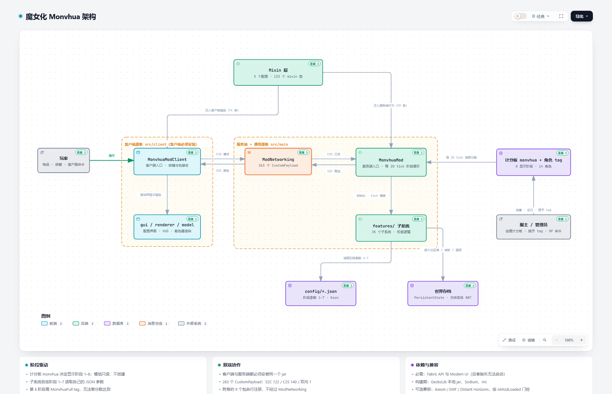

# 魔女化（Monvhua）

[](https://github.com/l4nternnn/monvhua-effect/releases)
[](https://www.minecraft.net/)
[](https://fabricmc.net/)
[](LICENSE)

> 把「魔女化」做成可量化阶段的 Minecraft 模组：一条计分板控制玩家的魔女化进度，角色 tag 决定他是谁，
> 再围绕阶段数值挂上千里眼、模仿、搬运、身体部件、镜像、重力、绘画、穿墙等一整套能力。
> **客户端与服务端都必须安装。**

- 模组 ID `monvhua`｜当前版本 `1.0.14`｜作者 kuilunfuzhe、shushuwonie
- 仓库：<https://github.com/l4nternnn/monvhua-effect>

## 架构总览



横轴是「玩家 → 客户端入口 → 网络层 → 服务端入口」的主链路，节点上标注了对应源码位置；
另有[可交互版本](architecture/monvhua-architecture.html)（明暗主题、节点与路线检索、导出）。

---

## 1. 环境要求

| 项目 | 版本 | 说明 |
| --- | --- | --- |
| Minecraft | `1.21.8` | 声明为 `~1.21.8` |
| Fabric Loader | `>= 0.16.0` | 开发环境使用 `0.19.2` |
| Fabric API | `0.136.1+1.21.8` | 必需 |
| Modern UI | CurseForge `modern-ui` | **硬依赖**，缺失无法启动（GUI 框架） |
| Java | `21` 或更高 | 编译目标为 Java 21 |
| 运行环境 | 客户端 + 服务端 | 同一个 jar，两端都要装 |

### 可选与兼容

| 模组 | 关系 | 说明 |
| --- | --- | --- |
| GeckoLib `5.2.2` | 本地 jar 参与编译 | 骨架身体部件与命令面板的几何动画 |
| Sodium | **客户端事实硬依赖（未声明）** | 传送门模块有 3 个 mixin 直接指向 Sodium 类，位于必需配置中且没有 `@Pseudo` 回退 |
| Iris | 运行时可选 | 镜像管线与传送门表面的兼容 mixin，由插件按 `isModLoaded("iris")` 门控 |
| Axiom | 可选（仅编译期） | 区域提示的选区集成与编辑器中文字体修复 |
| Entity Model Features (EMF) | 可选 | 搬运抱姿的上半身动画兼容 |
| Distant Horizons | 可选 | 镜像渲染时暂停 LOD（纯反射，无 mixin） |
| Better Command Block UI | 可选（仅编译期） | 命令面板指令编辑器增强 |

> 未安装 Sodium 的客户端很可能直接崩溃（未实测）。反转载入相关的 3 个 Sodium mixin 带 `@Pseudo`，缺少时可安全跳过。

---

## 2. 安装

1. 从 [Releases](https://github.com/l4nternnn/monvhua-effect/releases) 下载 `monvhua-<版本>.jar`。
2. **客户端**与**服务端**的 `mods/` 目录各放一份。
3. 确认已安装上表的必需依赖（Fabric API、Modern UI）。
4. 启动服务端后，管理员需要**手动创建计分板**（模组不会自动创建）。

---

## 3. 快速开始：计分板、角色与阶段

### 3.1 创建计分板

模组**只读取**名为 `monvhua` 的计分板目标。目标不存在时，对应玩家的阶段逻辑会被整体跳过。

```mcfunction
/scoreboard objectives add monvhua dummy 魔女化
/tag @s add ema
/scoreboard players set @s monvhua 45
```

### 3.2 角色 tag

角色由玩家 tag 决定，共 14 个：

| tag | 角色 | tag | 角色 |
| --- | --- | --- | --- |
| `ema` | 樱羽艾玛 | `yalisa` | 紫藤亚里沙 |
| `cero` | 二阶堂希罗 | `noa` | 城崎诺亚 |
| `nnk` | 黑部奈叶香 | `anan` | 夏目安安 |
| `mago` | 宝生玛格 | `yuki` | 月代雪 |
| `leiya` | 莲见蕾雅 | `mll` | 冰上梅露露 |
| `milya` | 佐伯米利亚 | `coco` | 泽渡可可 |
| `sherry` | 橘雪莉 | `hanna` | 远野汉娜 |

### 3.3 阶段阈值

分数每 20 tick 读取一次，映射到 8 个显示阶段：

| # | 阈值 | 枚举 | 显示名 | 类别 | 颜色 |
| --- | --- | --- | --- | --- | --- |
| 1 | `0` | `SANE` | 神智清醒 | BENEFICIAL | `#55FF55` |
| 2 | `10` | `TAINTED` | 略染污浊 | BENEFICIAL | `#00AA00` |
| 3 | `25` | `LIGHT` | 轻度魔女化 | NEUTRAL | `#FFFF55` |
| 4 | `45` | `MEDIUM` | 中度魔女化 | NEUTRAL | `#FFAA00` |
| 5 | `60` | `HIGH` | 高度魔女化 | HARMFUL | `#FF5555` |
| 6 | `70` | `SEVERE` | 重度魔女化 | HARMFUL | `#AA0000` |
| 7 | `80` | `PROTO_WITCH` | 准魔女 | HARMFUL | `#FF55FF` |
| 8 | — | `WITCH` | 魔女 | HARMFUL | `#AA00AA` |

> 第 8 阶段**无法靠分数达到**：分数 ≥ 80 且带 `MonvhuaFull` tag 时才晋升。
> 子系统配置用的是另一套编号（`stages` 数组为 **1–7**，区间 `0-9 / 10-24 / 25-44 / 45-59 / 60-69 / 70-79 / 80-100`）；
> 且**阶段并非全局门槛**，只有重力（抓方块群需 ≥ 6）、模仿、镜像等少数系统读分数，附身、传送门、秋千、牵手、绘画等完全不看。

### 3.4 显示用状态效果

注册了 **112 个纯显示状态效果**（14 角色 × 8 阶段），ID 为 `monvhua:<角色>_<阶段>`，如 `monvhua:ema_5`。
它们只有图标、没有药水逻辑，全部无限时长；阶段变化时替换旧效果并推送提示与角色台词。

### 3.5 其他会被识别的 tag

| tag | 作用 |
| --- | --- |
| `MonvhuaFull` | 分数 ≥ 80 时晋升第 8 阶段；创造级飞行的前置 |
| `Floating` | 允许双击跳跃漂浮 |
| `Silenced` | 禁用部分物品（千里眼、昔今之镜、重力魔杖、附身、穿墙），不是全局禁魔 |
| `Healed` | 幻想字幕系统视为分数 0 |
| `kebao` | 允许抱起他人（非创造模式） |
| `qiangzhiai` / `strong_power` | 大幅降低被抱者的挣脱难度 |
| `kaibao` | 非创造模式下打开他人背包 |
| `dead_body` / `dead_part` | 身体部件死亡掉落 |
| `save_backpack` | 热背包存档的默认归档对象（带此 tag 者死亡时被抢救） |
| `ui_edit` | 允许同步命令面板配置 |
| `eye_ignore`（实体 tag） | 千里眼自动标记时忽略该实体 |
| `monvhua_avatar:<key>` | 活动气泡使用的角色头像 |

---

## 4. 系统总览

| 系统 | 一句话说明 | 主要触发方式 |
| --- | --- | --- |
| 魔女化阶段 | 计分板驱动 112 个显示效果、阶段提示与角色台词 | 计分板 + tag |
| 千里眼 | 标记实体与锚点、观看目标视角、洞察印记与能量管理 | `monvhua:clairvoyance`、`V` 键 |
| 视线诱导 | 用魔法棒制造视线焦点，强迫被标记实体看向焦点 | `monvhua:magic_stick` 长按右键 |
| 模仿 | 扮演 15 个角色（含「典狱长」）、声波震荡与静音 | `monvhua:imitate_book` |
| 搬运 | 抱起玩家／生物，含完整的抱姿、相机与渲染重定向 | 潜行空手右键生物 |
| 身体部件 | 6 个部位方块：死亡掉落、拾取、放置、合并、换肤 | 方块物品 + 死亡掉落 |
| 骨架部件 | GeckoLib 驱动的骨骼身体部件，支持关节 bend 姿态 | 方块 + 姿态命令 |
| 身体姿态编辑器 | 3D 姿态编辑、预设、世界放置与预览 | `B` / `P` 键 |
| 动作系统 | JSON 驱动的动作、触发器与时间线引擎 | `J` 键 + 命令 |
| 镜像 | 第三人称镜像视口，用 FBO 重新渲染世界（实现上为单视口） | `monvhua:mirror_of_then_and_now` |
| 漂浮 | 双击跳跃漂浮、满魔女创造飞行、能量条 | 双击跳跃 |
| 重力 | 定向受力／表面行走两种逻辑、区域重力与反转区域，配套倒置方块／流体渲染 | `monvhua:gravity_wand`、Ctrl+滚轮、Ctrl+中键 + 命令 |
| 传送门 | 框架围成的成对光门，另有远程区块推流视图 | 方块 + 界面 |
| 绘画与涂鸦 | 在方块面、玩家皮肤与模型上逐像素绘制、图片导入 | 画笔／喷漆罐／油漆桶 |
| 画板 | 可放置的两格高像素画板，自带完整绘制界面 | `monvhua:drawing_board` |
| 文字区域 | 2D HUD 文字组与背景图；区域与配置来自服务端 | 进入区域自动播放 / `U` 键 → 配置面板 |
| 区域提示 | 自定义区域、进入提示、线框与自定义 HUD | `monvhua:area_tip_stick` |
| 活动气泡 | 聊天／写字／开箱／吃东西／睡觉时的头顶气泡与头像 | 自动 |
| 命令面板 | 手持面板物品执行指令、显示玩家状态 | `monvhua:command_panel` |
| 箱子映射 | 入口箱与源箱永久绑定，远程开箱 | `monvhua:chest_link` |
| 秋千 | 用组装棒把绳索＋座位结构收成可摆动的秋千实体 | `monvhua:assemble_stick` |
| 穿墙／隐秘 | 长按右键进入相位状态：清空碰撞形状穿过方块。**不含隐身** | `monvhua:through` 长按右键 |
| 附身 | 用附身棒夺取另一名玩家的控制权 | `monvhua:possession_wand` |
| 牵手 | 双人刚性牵手，客户端改用烘焙刚体手臂 | 鼠标中键（潜行） |
| 幻想字幕 | 按阶段推送幻想台词、乱码与负面效果 | 被动 |
| 消散 | 噪声扫描逐像素消融，结束时击杀 | 命令 |
| 故障／玩家故障 | 故障平面随机闪烁、玩家模型碎片抖动 | 命令 |
| 黑洞 | 自定义着色器引力透镜方块 | 放置 `monvhua:block_hole` |
| 植物魔法 | 催熟周围作物、搬运树叶、放置蜘蛛网 | `monvhua:plant_wand` |
| 受伤出血 | 受伤时的出血、血渍与蝴蝶粒子表现 | 被动 |
| 热背包存档 | 按 tag 批量保存／恢复玩家状态，并抢救死亡 | 命令 |
| 玩家列表限制 | 限制生存／冒险玩家的 Tab 列表可见性 | 命令 |
| 气泡头像编辑 | 活动气泡头像的位置／缩放／风格编辑 | 配置面板 |

---

## 5. 玩家操作手册

### 5.1 按键绑定

按键注册在分类 `category.monvhua` 下，可在原版按键设置里修改。

| 默认键 | 翻译键 | 作用 | 限制 |
| --- | --- | --- | --- |
| `U` | `key.monvhua.config` | 打开配置中心（11 个系统页 + 阶段区间 + UI 缩放） | 仅创造模式 |
| `V` | `key.monvhua.mark` | 按主手物品分派：模仿物→区域标记；千里眼→标记实体／放置锚点；魔法棒→视线诱导；其他→查看他人背包 | 部分分支限创造 |
| `B` | `key.monvhua.body_pose_editor` | 打开身体姿态／模型编辑器 | 部分分支限创造 |
| `P` | `key.monvhua.body_pose_world_preview` | 切换身体姿态世界预览／放置模式 | 仅创造模式 |
| `J` | `key.monvhua.action_editor` | 打开动作编辑器 | 仅创造模式 |
| 鼠标中键 | `key.monvhua.hold_hands` | 牵手（需潜行，且准星命中另一名玩家） | — |
| `←` | `key.monvhua.command_panel_previous` | 命令面板上一入口（需面板 UI 可见且主手持有面板） | — |
| `→` | `key.monvhua.command_panel_next` | 命令面板下一入口 | — |

> `key.monvhua.config`、`command_panel_previous`、`command_panel_next` 三个翻译键在语言文件中缺失，会显示原始键名。

### 5.2 物品一览

> 这些物品**没有配方**，目前只能从创造模式物品栏获取；自定义分组为 `monvhua:main_group`。

| 物品 ID | 名称 | 用途 |
| --- | --- | --- |
| `monvhua:clairvoyance` | 千里眼 | 打开千里眼界面；受每日次数限制；带 `Silenced` 时被拒绝 |
| `monvhua:imitate_book` | 模仿之书 | 打开模仿界面 |
| `monvhua:magic_stick` | 视线诱导魔法棒 | 长按右键制造视线焦点 |
| `monvhua:mirror_of_then_and_now` | 昔今之镜 | 开启／关闭镜像视口；需充能成功才有次数 |
| `monvhua:gravity_wand` | 重力魔杖 | 右键方块面选面、潜行作用于自身、非潜行抛掷方块群；Ctrl+滚轮调力 |
| `monvhua:gravity_debug_stick` | 重力调试棒 | 区域场调试：右键放置与移动、持有时 `B` 打开调试界面 |
| `monvhua:area_tip_stick` | 区域提示棒 | 两次右键预览并放置区域；潜行右键开配置 |
| `monvhua:plant_wand` | 肆意滋生 | 手持催熟作物；潜行右键搬运树叶；非潜行右键放置蜘蛛网柱 |
| `monvhua:assemble_stick` | 秋千组装棒 | 把附近结构组装成秋千 |
| `monvhua:through` | 穿墙 | 长按右键进入相位状态 |
| `monvhua:possession_wand` | 附身 | 右键另一名玩家夺取控制权 |
| `monvhua:chest_link` | 箱子映射器 | 分两次潜行右键登记源箱与入口箱，之后空手右键入口箱即可远程开箱 |
| `monvhua:command_panel` | 典狱长配置面板 | 手持执行指令、查看玩家状态；GeckoLib 开关动画 |
| `monvhua:paint_brush` | 画笔 | 逐像素绘制（≤100 像素，1 个颜色槽） |
| `monvhua:paint_spray_can` | 喷漆罐 | 同上，喷漆形态 |
| `monvhua:eraser` | 橡皮 | 擦除绘制内容 |
| `monvhua:paint_paper` | 画纸 | 承载导入图片生成的绘画数据（堆叠 64） |
| `monvhua:paint_bucket` | 油漆桶 | 绘画用方块，颜色存于 `CUSTOM_MODEL_DATA` |
| `monvhua:drawing_board` | 画板 | 放置两格高画板并打开绘制界面 |
| `monvhua:block_hole` | 黑洞 | 引力透镜视觉方块 |
| `monvhua:light_portal` / `monvhua:light_portal_frame` | 传送门／框架 | 搭建成对传送门 |
| `monvhua:torso`、`left_arm`、`right_arm`、`left_leg`、`right_leg`、`head` | 身体部件 | 放置为身体部位展示实体 |
| `monvhua:skeletal_*`（6 个） | 骨架身体部件 | GeckoLib 骨架版本 |

### 5.3 命令速查

`OP` = 需要权限等级 2；未标注者普通玩家可用（多数仍要求执行者是玩家）。

#### 阶段、千里眼与观看

| 命令 | 权限 | 作用 |
| --- | --- | --- |
| `/clairvoyance_千里眼 clearanchors_清除锚点` | 玩家 | 清除自己的千里眼锚点 |
| `/clairvoyance_千里眼 clearanchors_清除锚点 <player>\|all_全部` | OP | 清除指定玩家或全部千里眼锚点 |
| `/clairvoyance_千里眼 viewmode_观看模式 [legacy_旧版\|modern_新版\|viewport_预览]` | 玩家 | 查询或切换千里眼观看模式 |
| `/clairvoyance_千里眼 viewlogic_显示逻辑 [six_六视角\|single_单视角]` | 玩家 | 查询或切换六视角／单视角 |
| `/clairvoyance_千里眼 resetcooldown_重置冷却 [<target>]` | 玩家（带 target 需 OP） | 重置视线诱导冷却 |
| `/clairvoyance_千里眼 clearmarks_清除诱导标记实体` | OP | 清除视线诱导的标记实体 |
| `/clairvoyance_千里眼 toggleimages_开关图片 <target>` | OP | 切换目标的图像显示 |
| `/clairvoyance_千里眼 toggleparticles_开关粒子 <target>` | OP | 切换目标的粒子显示 |
| `/watch_观看 [<target>]` | 玩家 | 观察准星指向的实体，或按名称查找；再次执行停止 |
| `/watch angle_角度 <yaw> <pitch> <distance\|reset_重置>` | 玩家 | 设置或重置观看相机偏移（距离 0.5–10） |

#### 身体部件、骨架与镜像

| 命令 | 权限 | 作用 |
| --- | --- | --- |
| `/clairvoyance-body-give_肢体获取 <target> <source> <all_全部\|part> [slim_纤细]` | OP | 把来源玩家的身体部件给予目标玩家 |
| `/clairvoyance-body-give_肢体获取 <target> localskin_内置 <skinName> <all_全部\|part> [slim_纤细]` | OP | 使用内置皮肤生成身体部件 |
| `/clairvoyance-body-replace_肢体替换 localskin_内置 <skin> \| player_玩家 <name> [slim_纤细]` | OP | 替换周围 3 格内的部件展示实体 |
| `/clairvoyance-body-replace_肢体替换 split_分离` | OP | 把整体展示实体拆分为头、躯干与四肢 |
| `/clairvoyance-body-merge_肢体合并` | OP | 合并附近的部件展示实体 |
| `/clairvoyance-body-clear-inventory-entities_清除背包实体 [<radius>]` | OP | 清除附近背包中的部件实体（默认 4，范围 0.5–64） |
| `/monvhua-skeletal-pose_骨骼姿态 <pos> <pitch> <yaw> <roll>` | OP | 设置骨骼身体方块姿态（各轴 -180–180） |
| `/clairvoyance-mirror_镜像 set_设置 <1\|2> hspos_设定点 <pos>` | OP | 设置镜面槽位触发点 |
| `/clairvoyance-mirror_镜像 set_设置 <1\|2> mappos_映射点 <pos>` | OP | 设置镜面槽位映射点 |
| `/clairvoyance-mirror_镜像 set_设置 <1\|2> radius_半径 <radius>` | OP | 设置触发半径（1–200） |
| `/clairvoyance-mirror_镜像 remove_移除 <1\|2> \| clear_清除 \| list_列出所有` | OP | 移除槽位、清除全部或列出配置 |

#### 搬运、重力与秋千

| 命令 | 权限 | 作用 |
| --- | --- | --- |
| `/carry-pose_搬运姿势 [princess_公主抱\|drag_拖拽\|toggle_切换]` | 玩家 | 查询、设置或切换抱姿 |
| `/carry-stamina-rate_搬运耐力倍率 [<amount>]` | OP | 查询或设置每秒耐力消耗（0–100） |
| `/carry-xp-rate_搬运经验倍率 [<amount>]` | OP | 上一命令的兼容别名 |
| `/monvhua-carry-pose-transform_搬运姿势变换 [princess\|drag] <set_设置\|add_追加\|reset_重置> …` | 玩家 | 设置／追加被抱实体的位移与旋转 |
| `/monvhua-carry-view-transform_搬运视角变换 [princess\|drag] <set_设置\|add_追加\|reset_重置> …` | 玩家 | 设置／追加被抱玩家的视角变换 |
| `/monvhua-gravity_重力 logic_逻辑 <force_强制\|surface_表面\|toggle_切换\|show_显示>` | OP | 设置、切换或查看重力逻辑（作用于所有在线玩家） |
| `/monvhua-gravity_重力 area_区域 create_创建 <radius> [<height>] <time>` | OP | 创建区域重力（半径／高度 1–256，时间为秒或 `wuxian`） |
| `/monvhua-gravity_重力 area_区域 clear_清除 <nearest_最近\|all_全部>` | OP | 清除最近或全部区域重力 |
| `/monvhua-swing diagnose <beam>` | OP | 只读诊断指定摆体梁位置 |
| `/monvhua-swing stats` | OP | 查看附近摆体结构、碰撞盒与缓存统计 |
| `/monvhua-swing restore` | OP | 恢复并移除最近的摆体结构 |
| `/monvhua-swing remove` | OP | 移除最近的摆体实体但不恢复方块 |

> 抱人与牵手没有聊天命令：抱人需**潜行 + 空手右键生物**，牵手需**潜行 + 鼠标中键**且准星命中另一名玩家。
> 传送门也没有命令：用 `light_portal_frame` 围出闭合矩形后右键激活，再在界面里把两个门命名成同一组。

#### 绘画、动作与消散

| 命令 | 权限 | 作用 |
| --- | --- | --- |
| `/monvhua-graffiti_绘画 folder_文件夹` | OP | 创建并打开游戏目录下的 `graffiti/` 导入目录 |
| `/monvhua-graffiti_绘画 import_导入 <file>` | OP | 按原尺寸异步导入图片并生成画纸 |
| `/monvhua-graffiti_绘画 import_scaled_缩放导入 <scale> <file>` | OP | 按倍率导入（0.05–8.0，最多 25×25 张画纸） |
| `/monvhua-graffiti_绘画 allow_non_full_blocks_非完整方块绘画 [on\|off]` | OP | 查询或设置是否允许在非完整方块表面绘画 |
| `/monvhua-graffiti_绘画 clear_清除 grid_网格\|block_方块 <radius> [<center>]` | OP | 按方块半径清除（0–2048） |
| `/monvhua-graffiti_绘画 clear_清除 chunk_区块 <radius> [<center>]` | OP | 按区块半径清除（0–128） |
| `/monvhua-action_动作 reload_重载 \| list_列表 \| trigger_触发 <id> [<player>] \| enable_启用 <id> \| disable_禁用 <id>` | OP | 动作配置管理 |
| `/monvhua-dissolve_消散 <target> [<durationTicks>]` | OP | 开始消散效果（1–1200 tick） |
| `/monvhua-dissolve_消散 stop <target>` | OP | 停止消散 |

#### 故障、气泡、面板与存档

| 命令 | 权限 | 作用 |
| --- | --- | --- |
| `/monvhua glitch create <name> <from> <to>` | OP | 创建故障平面（单轴、面内边长 ≤ 64） |
| `/monvhua glitch start\|stop <name>` | OP | 启用／停用故障平面 |
| `/monvhua glitch remove <name> \| list` | OP | 删除或列出故障平面 |
| `/monvhua glitch set <name> density <0..1> \| rate <1..20> \| seed <long>` | OP | 调整密度、刷新间隔与随机种子 |
| `/monvhua playerglitch start\|stop\|limit <target> <fragments 1-256> <offset 0-0.12>` | OP | 玩家模型故障表现 |
| `/commandpanel reload` | OP | 重新加载命令面板配置 |
| `/commandpanel sync <targets>` | 创造 + `ui_edit` | 把自己的命令面板配置同步给目标玩家 |
| `/monvhua-bubble-size <multiplier> \| reset` | OP | 设置或重置气泡尺寸倍率（0.25–4） |
| `/monvhua-bubble-style <pixel\|default\|reset>` | OP | 设置气泡渲染样式 |
| `/monvhua-player-archive-save_玩家存档保存` | OP | 保存带 `save_backpack` tag 的在线玩家存档 |
| `/monvhua-archive save <tag>` | OP | 为带指定 tag 的在线玩家创建批次存档 |
| `/monvhua-archive apply <tag> [<timestamp>]` | OP | 恢复到最近批次或指定时间戳批次 |
| `/restrict_限制 playerlist_玩家列表 <true\|false>` | OP | 全局开关生存／冒险玩家的 Tab 列表限制 |

#### 仅客户端命令

| 命令 | 作用 |
| --- | --- |
| `/monvhua-carry-debug-transform_搬运调试变换` | 输出抱姿、相机与矩阵调试信息并复制到剪贴板 |
| `/monvhua-carry-pose-transform_搬运姿势变换 …` | 客户端发送抱姿变换请求 |
| `/monvhua-carry-view-transform_搬运视角变换 …` | 客户端发送视角变换请求 |
| `/monvhua-textarea-reset_文字区域重置` / `/monvhua-text-reset_文字重置` | 清除本玩家的文字区域播放计数 |
| `/monvhua-swing-render-stats` | 输出摆体渲染统计 |
| `/clearentitypaint_清除实体画迹 [<targets>]` / `/clearplayerpaint_清除玩家画迹 [<targets>]` | 清除玩家皮肤上的绘画覆盖 |

---

## 6. 配置与数据

### 6.1 配置文件

配置使用 Gson pretty-print 保存，**绝大多数直接放在 `config/` 根目录**；`config/monvhua/` 下只有动作配置、文字区域播放计数与区域提示贴图。

| 文件 | 内容 |
| --- | --- |
| `config/clairvoyance_global.json` | 千里眼 7 阶段限制：每日次数、标记上限、标记过期、锚点上限、能量消耗／恢复 |
| `config/monvhua/actions.json`（+ `actions/`） | 动作定义、触发器与时间线 |
| `config/imitate.json` | 模仿：声波／静音／区域选择的解锁阈值 + 7 阶段参数 |
| `config/mirror.json` | 镜像 7 阶段：观看时长、成功率、视图数、半径、充能时间 |
| `config/mirror_display.json` | 镜像视口尺寸与扇区角度。**源码从未接入，属死配置** |
| `config/mirror_data.json` | 按玩家 UUID 保存的 2 个镜面槽位坐标与半径 |
| `config/gazeguidance.json` | 视线诱导：能量上限 + 7 阶段的消耗、恢复、半径、标记上限 |
| `config/floating.json` | 漂浮：能量上限 + 7 阶段的消耗、飞行速度、恢复 |
| `config/gravity.json` | 重力：施加时长、伤害换算、表面移动消耗 + 8 组 7 阶段数值 |
| `config/through.json` | 穿墙：7 阶段的速度倍率与消失延迟（负值表示禁止） |
| `config/secret.json` | 隐秘／窃密 7 阶段的生效范围与概率 |
| `config/plant_magic.json` | 植物魔法：7 阶段的叶片速度、覆盖角、冷却 |
| `config/paint.json` | 绘画：画笔消耗倍率、油漆桶装填次数 |
| `config/dissolve.json` | 消散：速度与像素粒子寿命（其余参数硬编码） |
| `config/injured_bleeding.json` | 受伤出血：喷溅、粒子频率、血渍消退、蝴蝶概率等 |
| `config/area_tip.json` | 区域提示：区域组定义（形状、尺寸、消息、HUD 文本） |
| `config/monvhua/text_area_playback_counts.json` | 文字区域播放计数（键为 `玩家UUID:条目ID`） |
| `config/monvhua_body_pose_defaults.json` | 默认体型、默认姿态模式、世界预览默认模式 |
| `config/monvhua_carry_transform.json` | 公主抱／拖拽的姿势与视角偏移 |
| `config/monvhua_bubble_avatar_layout.json` | 活动气泡头像的位置、缩放与风格 |
| `config/monvhua_combined_config_screen.json` | 配置中心 UI 缩放（0.6–1.6） |
| `config/monvhua_ui_layouts.json` | 可拖拽界面布局（按命名空间保存） |
| `config/monvhua_command_panel.json` | 命令面板的页面、弹窗与预览配置（客户端侧文件） |
| `config/monvhua_playerlist_restrict.json` | 玩家列表限制开关 |
| `config/body_pose/body_pose_editor.json` | 姿态编辑器页面、预设与编辑状态 |
| `config/monvhua/textures/` | 区域提示与文字区域使用的自定义背景贴图 |

多数配置的修改流程是：客户端 C2S 上报 → 服务端校验（权限 2 或创造）→ 落盘 → 广播所有在线玩家。
少数子系统没有 JSON 配置：传送门用硬编码常量类，附身、牵手、秋千完全是运行时内存状态。

### 6.2 世界存档数据

以下状态随地图保存，换图或删档会丢失：

| 数据 | 载体 |
| --- | --- |
| 区域提示 | PersistentState `monvhua_area_tips` |
| 箱子映射 | PersistentState `monvhua_chest_links` |
| 故障平面 | PersistentState `monvhua_glitch_planes`（按维度） |
| 传送门分组 | PersistentState `monvhua_portal_groups`（按维度） |
| 命令面板 | PersistentState `monvhua_command_panels` |
| 涂鸦覆盖 / 画纸数据 | PersistentState `monvhua_paint_overlays` / `monvhua_paint_papers` |
| 重力区域 | 存档根 JSON `monvhua_gravity_areas.json` |
| 热背包存档 | 存档根 JSON `monvhua_hot_backpack_save.json`（每玩家上限 48 条） |
| 画板 / 传送门 / 秋千 / 油漆桶 | 各自方块实体或实体自身的 NBT |

**不持久化**（重启即重置）：搬运、牵手、附身、千里眼标记与锚点、玩家故障、消散、植物魔法的叶片旅程、重力提取与持块群。

---

## 7. 兼容性与已知限制

### 兼容性

- **必须**安装 Modern UI，否则模组无法加载。
- GeckoLib 以本地 jar 参与编译，**未打包进产物**，也**未写入 `depends`**。
- **Sodium 事实上是客户端硬依赖**：传送门模块的 3 个 mixin 直接指向 Sodium 类（`ChunkBuilder`、`ChunkJobTyped`、
  `SodiumWorldRenderer`），既无 `@Pseudo` 也无插件门控，却列在必需的客户端 mixin 配置中；`fabric.mod.json` 未声明该依赖。
  未安装 Sodium 时是否崩溃**未经实测**。
- Iris／Axiom／EMF 的兼容 mixin 都在独立配置中由插件按 `isModLoaded` 门控，模组缺失时整体跳过。
- Distant Horizons 仅通过反射交互，无 mixin。

### 已知限制

1. **模组不会自动创建计分板**。`monvhua` 目标缺失时，该玩家的阶段逻辑被整体跳过。
2. **两套阶段编号容易混淆**：显示效果是 1–8，子系统配置是 1–7；第 8 阶段不参与数值配置。
3. **角色名单三处不一致**：`WitchRole` 14 个、模仿系统 15 个（多一个「典狱长」）、命令面板 23 个白名单。
4. **`en_us.json` 缺少 39 个键**（含全部 `sound.monvhua.*`、`command.monvhua.commandpanel.*` 与部分物品／方块名），
   英文环境会显示原始键名；另有 12 个骨架部件键只有英文。请以 `zh_cn.json` 为准。
5. **物品没有配方**，只能从创造模式物品栏获取。
6. **部分代码已停用**：`/placemannequin`（未注册）、画纸的贴回／保存逻辑（注释写明 temporarily disable）、
   `ThroughItem` 的隐身／失明／黑暗药水效果（三处均被注释，实际只做相位免碰撞）、`EyeAnimationHelper` 整文件、
   `StageConfigScreen` 整文件、`BackTextureRenderer`／`OrbitRenderer` 的调用，以及 `mirror_display.json`。
7. **4 个网络包永不注册**，`ModPackets` 是零引用的死类；`ExampleMixin`／`ExampleClientMixin` 模板仍在配置中启用。
8. **3 个 mixin 未登记进任何配置**，因此不会生效（`ServerPlayNetworkHandlerMixin`、`CarrierAttachedEntityRenderMixin`、
   `FirstPersonCarriedPlayerHeadHideMixin`）。
9. **客户端发包封装不统一**：约 82 处走 `SafeClientNetworking.send()`，另有约 100 处直接调用 `ClientPlayNetworking.send()`。
10. **画板**：方块实体渲染器的纹理按坐标常驻、永不回收（长时间游玩存在显存增长）；
    最大分辨率 1024×1536 时单次全量同步约 6 MB 且无分片，广播半径 128 格会成倍放大。
11. **消散配置共 28 个参数，其中仅 2 个可在 JSON 中配置**，其余 26 个硬编码。
12. **骨架身体部件的 `registerControllers()` 是空实现**，没有动画控制器。
13. **客户端漂浮检测跑在 `java.util.Timer` 线程**（每 50 ms），会跨线程访问客户端对象。
14. 千里眼的超时退出默认被系统属性关闭；其提示文案与实际判定不一致。
15. **未完成的批次缺少超时清理**：区域提示的选区放置只在正常完成时移除，中途放弃会残留；类似的长生命周期静态集合还有多处。
16. 部分玩家可见文案存在编码损坏（乱码），已知出现在千里眼与相机观看模块。
17. **多个 C2S 包缺少权限校验**：`gazeguidance` 的 `UpdateConfigC2S`（可改全服视线诱导配置）、`gravity` 的
    `AdjustGravityC2S`／`SelectBlocksC2S`、`hot_backpack_save` 的 `RequestStateC2S`／`ApplySnapshotToSelfC2S`
    （可把他人存档套到自己身上）、传送门的 `deleteGroup`。
18. **模仿的解锁阈值只在客户端校验**，服务端仅检查冷却；区域模仿的坐标、半径与角色名服务端不校验。
19. `playerlist` 开关在登录时只补发 `true`、从不补发 `false`，客户端状态断线后不复位，可能出现跨服残留隐藏。
20. **镜像实际是单视口**（注释与命名描述的「双视口」没有实现），且每帧的世界渲染开销翻倍。
21. **画纸导入依赖 Windows 的 PowerShell + WinForms 文件选择器**，非 Windows 平台不可用且没有提示。
22. 传送门为**单向穿越且不跨维度**；秋千的 `remove` 不还原方块；附身不接管目标血量。
23. 受伤出血的致命一击看不到血；画板超过 65536 像素差异时整幅撤销历史被静默丢弃。

---

## 8. 开发指南

### 8.1 源码结构

项目使用 Loom 的 `splitEnvironmentSourceSets()`，分为 `main`（通用 + 服务端）与 `client` 两个源集。

```text
src/main/java/com/kuilunfuzhe/monvhua/
  MonvhuaMod.java    入口：注册效果、网络包、命令、各子系统与 tick 循环
  WitchRole.java     14 个角色枚举        WitchStage.java   8 个阶段枚举
  command/  config/  effect/  entity/  event/  features/  item/
  mixin/    network/  screen/  sound/  util/

src/client/java/com/kuilunfuzhe/monvhua/
  MonvhuaModClient.java   客户端入口：渲染、GUI、HUD、按键与网络接收
  client/  compat/  event/  fantasy/  features/  gui/  mixin/
  model/   network/  register/  renderer/  util/

src/test/java/.../features/swing/SwingGeometryTest.java   唯一单元测试（秋千几何）
```

### 8.2 构建与运行

```bash
./gradlew build            # 完整构建 → build/libs/
./gradlew compileJava      # 仅编译通用／服务端源集
./gradlew runClient        # 启动测试客户端
./gradlew runServer        # 启动测试服务端
./gradlew test             # JUnit 测试
```

- Gradle wrapper 9.4.1（`distributionUrl` 指向阿里云镜像）；Loom 声明 `1.16-SNAPSHOT`。
- 可选编译依赖 Better Command Block UI 默认从 `run/mods/bettercommandblockui-0.5.3-1.21.7.jar` 读取，
  该路径不存在时用 `-PbetterCommandBlockUiJar=<路径>` 指定，否则客户端源集无法编译。
- GeckoLib 由 `libs/` 内的本地 jar 提供。

### 8.3 版本号会自动自增

`build.gradle` 在**配置阶段**就会改写 `gradle.properties`：命令行任务的最后一段名称属于
`build`／`assemble`／`jar`／`remapJar` 时，把 `mod_version` 的 **patch 位 +1**（后缀保留），并**写回文件**。
一次 Gradle 调用只自增一次；构建失败时也已经被改掉。因此构建后 `gradle.properties` 必然产生未提交改动，
而要构建出与仓库声明一致的版本，需先把 `mod_version` 临时设为 `目标版本 - 1`。

### 8.4 网络包与 Mixin

所有数据包使用 Fabric `CustomPayload` + `PayloadTypeRegistry`，主体为 `record + static Id + PacketCodec` 模式，
ID 形如 `monvhua:<snake_case>`。

- 共 **263 个 `CustomPayload`**（S2C 122、C2S 140、双向 1），其中 `network/` 包下 254 个，
  另有 9 个由附身子系统自行注册，不经过统一入口。
- 注册入口为 `network/ModNetworking.java` 的 `registerS2CPackets()`／`registerC2SPackets()`，两端各调用一次，
  由每个包内的静态标志保证幂等；此外 `MonvhuaMod` 内直接注册约 60 个包，部分子系统也自行注册。
  所以「全部经 `ModNetworking` 注册」并不成立。
- 客户端发包封装 `SafeClientNetworking.send()` 会做 `canSend` 检查并捕获异常，但并非所有调用点都使用它。

Mixin 共 **5 个配置**：

| 配置 | 环境 | 条目 | required | 说明 |
| --- | --- | --- | --- | --- |
| `monvhua.mixins.json` | 双端 | 39 | true | 重力、倒置区域、传送门、附身、聊天改写、秋千碰撞等 |
| `monvhua.client.mixins.json` | 客户端 | 74 | true | 搬运抱姿、相机、镜像、反转渲染、Sodium 兼容、附身输入等 |
| `monvhua.axiom_compat.mixins.json` | 客户端 | 6 | false | Axiom 兼容，插件按 `isModLoaded("axiom")` 判定 |
| `monvhua.iris_compat.mixins.json` | 客户端 | 2 | false | Iris 镜像管线与传送门着色器 |
| `monvhua.emf_compat.mixins.json` | 客户端 | 3 | false | EMF 抱姿动画兼容 |

### 8.5 测试与 CI

单元测试用 `./gradlew test`，目前只覆盖秋千几何。仓库里的 `.github/workflows/build.yml` 会执行 `./gradlew build`，
但 `.github/` 被 `.gitignore` 忽略且未提交，因此**当前不会实际运行**。

---

## 9. 资源与本地化

- 状态效果图标：`assets/monvhua/textures/mob_effect/<role>_<stage>.png`；内置皮肤：`textures/local_skin/`；
  可由 `scripts/generate_icon.py` 批量生成图标（需 Pillow）。
- 语言文件：`assets/monvhua/lang/{zh_cn,en_us}.json`。**以 `zh_cn.json` 为准**，`en_us.json` 缺 39 个键
  且另有 12 个骨架部件键为英文独有。
- 部分玩家可见文案硬编码在 Java 中（画板界面、传送门编辑器、服务端提示等），存在中英混排与编码损坏；
  秋千组装棒在两个语言文件里都没有名称。

---

## 10. 许可

本项目使用 [GNU General Public License v3.0](LICENSE)。作者：kuilunfuzhe、shushuwonie。
